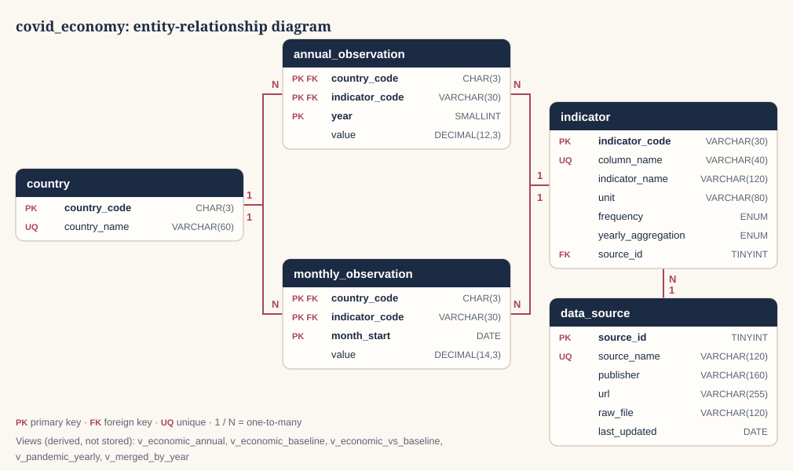

# Bonus challenge: MySQL relational database

> **Optional and separate from the main project.** Nothing in the dashboard, the analysis, or the findings depends on this folder, and the project runs and deploys without MySQL. The database is built from the same cleaned data, as an extra, so it can be checked against the dashboard.

The brief's optional bonus asks for a MySQL database hosting the study's datasets, with a justified architecture. This folder contains it:

| File | Purpose |
| --- | --- |
| `schema.sql` | Creates the `covid_economy` database: 5 tables, keys, constraints, and 5 views |
| `build_load_script.py` | Writes `load_data.sql` from the processed CSV files in `data/processed/` |
| `load_data.sql` | Generated INSERT statements (1,850 rows); do not edit by hand |
| `example_queries.sql` | Eight queries that reproduce results shown in the dashboard |
| `verify_database.py` | Compares the loaded database with the processed CSV files and tests the constraints |
| `er_diagram.svg` | Entity-relationship diagram |

The dashboard does **not** use the database: it still reads the processed CSV files, so the deployed app needs no database server (see [Connecting the dashboard](#connecting-the-dashboard-not-implemented)).

## Architecture



### Why this design

- **Reuses the existing pipeline.** The database is filled from the cleaned files in `data/processed/`, the same files the dashboard reads. There is no second cleaning pipeline.
- **Each fact is stored once.** The merged CSV files repeat every annual economic value in 12 monthly rows; here each value is stored once, and the merged tables are rebuilt by views. This is third normal form: every non-key column depends only on its table's primary key.
- **Long format for observations.** One row per country, indicator, and period, so a new indicator is new rows, not a new column.
- **Two observation tables, split by time grain.** World Bank data are annual (key: year); pandemic data are monthly (key: month). Separate tables keep each key simple and correctly typed (`SMALLINT` year vs `DATE` month).
- **Derived data are views.** Baselines, yearly pandemic totals, and the merged dashboard table are calculated from the observations, so they cannot drift out of date.
- **Missing means missing.** A missing value is an absent row, never zero. The 43 monthly cases and deaths values left empty by the cleaning (months with fewer than 15 reported days) have no row.

### Tables

| Table | Primary key | Foreign keys | Rows | Content |
| --- | --- | --- | --- | --- |
| `data_source` | `source_id` | — | 3 | World Bank WDI; WHO via Our World in Data; Oxford stringency index via Our World in Data |
| `country` | `country_code` (ISO-3) | — | 7 | The seven countries studied |
| `indicator` | `indicator_code` | `source_id` → `data_source` | 8 | 3 World Bank indicators (official codes) and 5 pandemic measures (project codes), with unit, frequency, and yearly aggregation rule |
| `annual_observation` | (`country_code`, `indicator_code`, `year`) | `country_code` → `country`; `indicator_code` → `indicator` | 147 | GDP growth, inflation, unemployment, 2018–2024 |
| `monthly_observation` | (`country_code`, `indicator_code`, `month_start`) | `country_code` → `country`; `indicator_code` → `indicator` | 1,685 | Cases and deaths per million (2020-01 to 2026-08, where reported) and three stringency indices (2020–2022) |

**Relationships (all one-to-many):** a data source provides many indicators; a country has many annual and many monthly observations; an indicator has many observations.

**Other constraints:**
- unique country names, indicator column names, and source names
- years between 1960 and 2100
- `month_start` must be the first day of a month
- annual indicators cannot have a yearly aggregation rule, and monthly ones must have one (`sum` or `mean`)

### Views

| View | Rebuilds |
| --- | --- |
| `v_economic_annual` | The three `*_annual.csv` files side by side |
| `v_economic_baseline` | Each country's 2018–2019 average per indicator (both years required) |
| `v_economic_vs_baseline` | Each annual value minus that baseline, in percentage points |
| `v_pandemic_yearly` | Yearly totals (cases, deaths) and means (stringency); `NULL` unless all 12 months have a value |
| `v_merged_by_year` | `data/processed/merged_dataset_by_year.csv` (2020–2022) |

## Set up the database

These steps use the MySQL 8 command-line client. On Windows it is at `C:\Program Files\MySQL\MySQL Server 8.0\bin\mysql.exe`; add that folder to PATH, or type the full path in place of `mysql`. Run from the project root. `-p` makes MySQL ask for your password, so it never appears in a file.

1. (Only if the processed data changed) regenerate the load script:

   ```powershell
   python database/build_load_script.py
   ```

2. Create the schema. This drops and rebuilds the `covid_economy` database:

   ```powershell
   mysql -u root -p -e "source database/schema.sql"
   ```

3. Load the data:

   ```powershell
   mysql -u root -p -e "source database/load_data.sql"
   ```

4. Check it against the processed CSV files:

   ```powershell
   python database/verify_database.py --user root --password
   ```

5. Run the example queries:

   ```powershell
   mysql -u root -p --table -e "source database/example_queries.sql"
   ```

On macOS/Linux, or in Command Prompt, `mysql -u root -p < database/schema.sql` also works. PowerShell does not support `<`, which is why the steps above use `source`. In MySQL Workbench, open each `.sql` file and run it (schema first, then data).

You can use a dedicated user instead of `root`, for example: `CREATE USER 'covid'@'localhost' IDENTIFIED BY '...'; GRANT ALL ON covid_economy.* TO 'covid'@'localhost';`

## Example queries

`example_queries.sql` contains:

1. Rows per table.
2. Indicators with their unit and source (join).
3. 2020 GDP growth against each country's own 2018–2019 average.
4. Unemployment change 2019–2020 (self-join).
5. Median GDP growth by year (window functions; MySQL has no `MEDIAN`).
6. Total reported deaths per million, 2020–2022.
7. Each country's strictest month (window function).
8. 2020 deaths, stringency, and GDP shortfall side by side (views joined).

Sample result of query 3, from the test run described below:

```text
+---------------+-----------------+----------+---------------+
| country       | gdp_growth_2020 | baseline | difference_pp |
+---------------+-----------------+----------+---------------+
| Rwanda        |          -2.777 |     8.68 |         -11.5 |
| India         |          -5.778 |     5.16 |         -10.9 |
| France        |          -7.441 |     1.84 |          -9.3 |
| Germany       |          -4.132 |     1.06 |          -5.2 |
| United States |          -2.081 |     2.78 |          -4.9 |
| Brazil        |          -3.277 |     1.50 |          -4.8 |
| China         |           2.340 |     6.41 |          -4.1 |
+---------------+-----------------+----------+---------------+
```

These match the dashboard and `findings_summary.md`: for example, US unemployment +4.4 pp, median GDP growth 2.6% / −3.3% / 6.9% (2019–2021), Brazil 3,296 deaths per million, and India's strictest month April 2020 (98.6).

## What was tested

**Verified on 20 October 2026,** on a temporary MySQL 8.0.43 Community Server instance on Windows:

- `schema.sql` and `load_data.sql` run without errors; the tables contain 3, 7, 8, 147, and 1,685 rows.
- `verify_database.py` passes 8 of 8 checks:
  - `v_economic_annual` equals the annual CSV files exactly.
  - Every monthly value equals the processed monthly files.
  - `v_merged_by_year` rebuilds `merged_dataset_by_year.csv`.
  - The Rwanda 2020 baseline difference is −11.5 pp.
  - The foreign-key, primary-key, and both check constraints reject invalid rows.
- All eight example queries run, with the results above.
- `tests/test_database_script.py` (part of the normal test suite, no MySQL needed) checks that `load_data.sql` matches the current processed data, that the row counts and keys are valid, and that the schema defines every table and view.

**One known difference:** `v_merged_by_year` gives France's 2022 average stringency as 19.91, while the CSV has 19.90. The exact mean is 19.905. MySQL rounds the exact decimal half up; the Python pipeline rounded a binary float (19.90499…). The verification allows up to 0.01 for this reason.

**Not tested:** MySQL Workbench, MariaDB, MySQL versions other than 8.0, cloud-hosted MySQL, and macOS/Linux shells.

## Connecting the dashboard (not implemented)

The deployed dashboard keeps reading the CSV files. A live database connection was considered and not implemented, because:

- **Hosting:** Streamlit Community Cloud cannot reach a database on a laptop. It would need a MySQL server reachable from the internet (a managed cloud service), which adds cost or free-tier limits and another service that can fail during the presentation.
- **Credentials:** the password would go in Streamlit's *Secrets* setting (or a local `.streamlit/secrets.toml`, which `.gitignore` excludes), never in the code or the repository. The app would use a read-only database user.
- **Code:** it would need `SQLAlchemy` and `PyMySQL` in `requirements.txt` and `st.connection("sql")` queries in `src/data/loader.py`, replacing the CSV reads.
- **Benefit:** the data are small (about 1,850 rows) and fixed, so reading them from CSV is faster and more reliable for this project.
